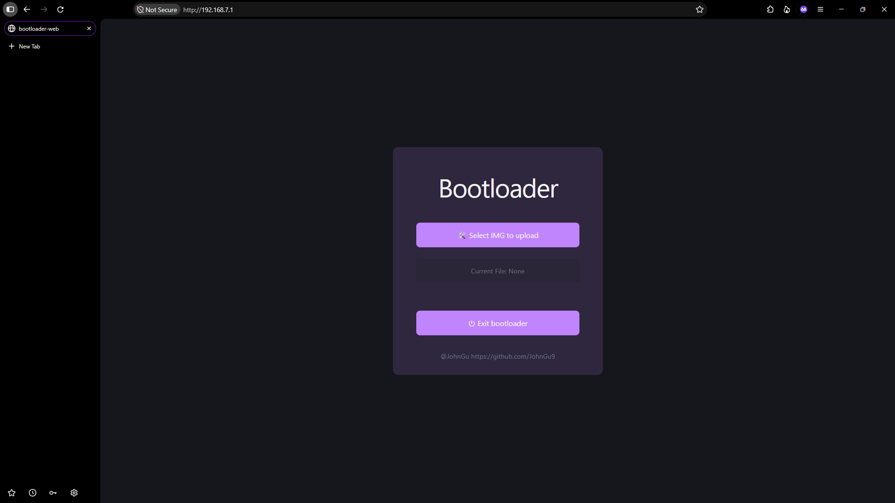

# Intro

A bootloader that support upload IMG file from web. (stm32h7)

# Build

1. build the project under [app/bootloader-web](app/bootloader-web) with `npm`/`nodejs` toolchain first.
2. build the root project.

# Merge

1. define your `bootloader-common-config.h` in the [common](common) directory
2. add the [common](common) directory in your app project's cmake.
3. link the library `bootloader_common` with `stm32cubemx`
4. link your project with `bootloader_common`

```cmake
add_subdirectory(path/to/this/project/common)
target_link_libraries(bootloader_common PUBLIC stm32cubemx)

...

target_link_libraries(${CMAKE_PROJECT_NAME}
    stm32cubemx
    bootloader_common
)
```

> Use `bootloader-common-config.h` require your platform hal file.

# Use

1. press the `k1` button (defined in stm32cube file) on your board while booting
2. connect your board with a pc via usb
3. visit the http://192.168.7.1/ on the pc



4. press `k1` button (defined in stm32cube file) on your board again or press the `Exit bootloader` button on the web to enter the app

# Warning

The IMG should be the raw bin file, not the elf file.

> You can use the [bin.cmake](common/bin.cmake) to convert your app elf file to a raw bin file.

```cmake
include(path/to/this/project/common/bin.cmake)
```

# Requirement

Flash size [Release < 128KB] [Debug < 256KB]

Memory size [128KB]

> build with default stm32 gcc toolchain
